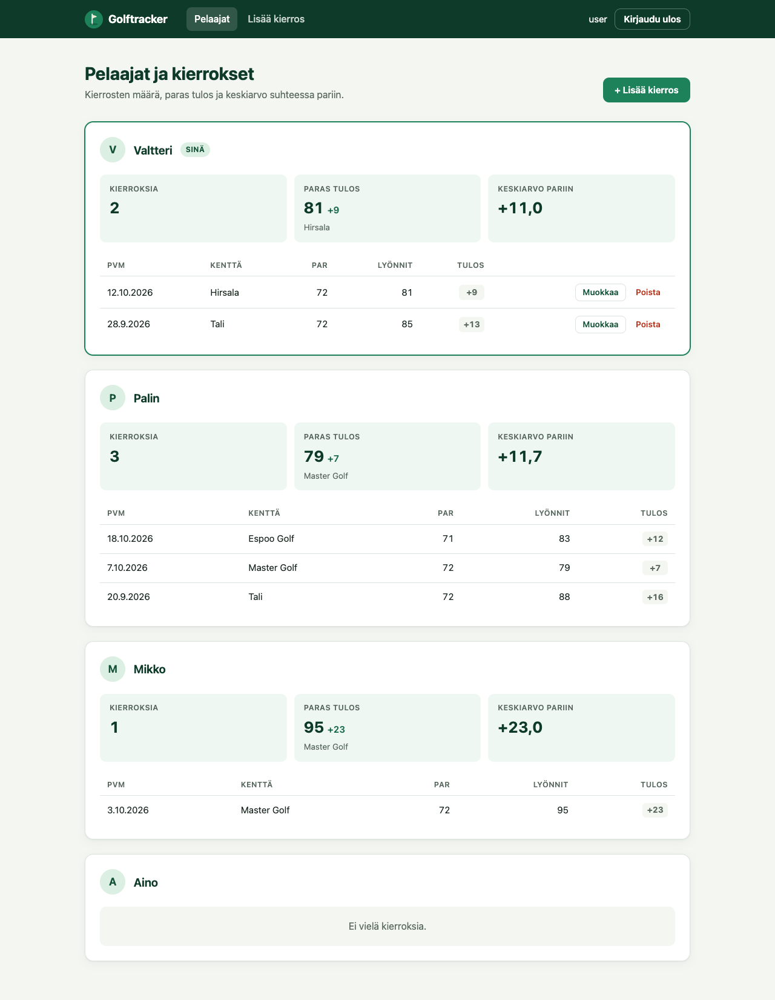
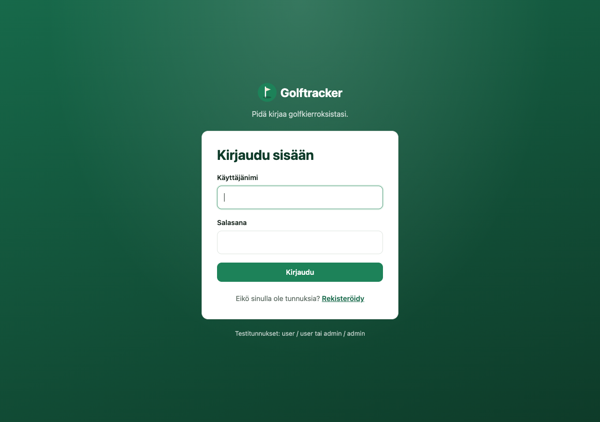
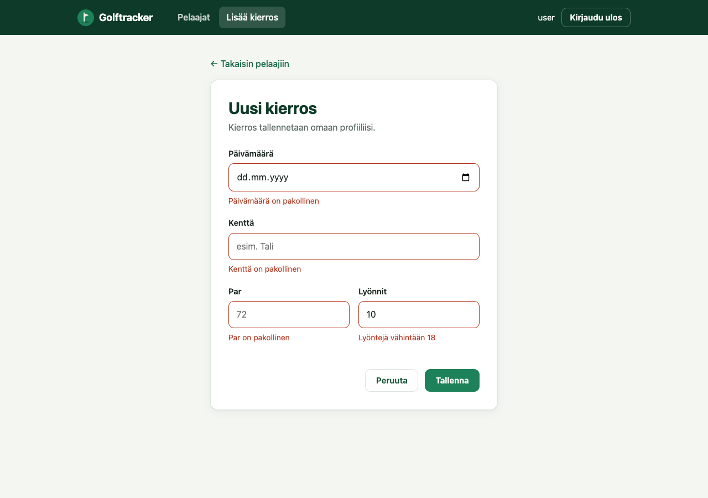
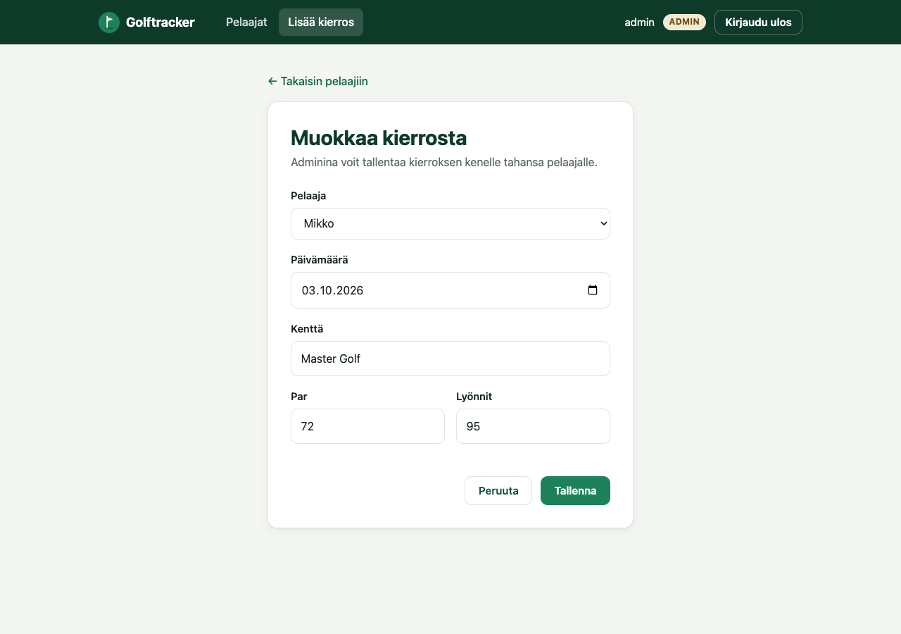
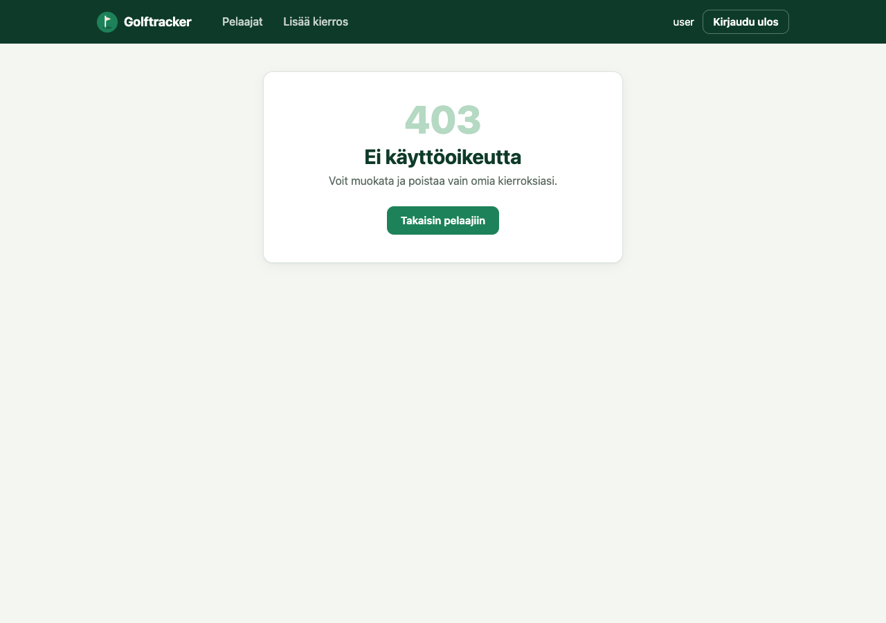
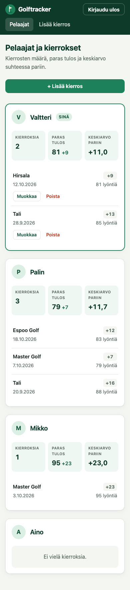
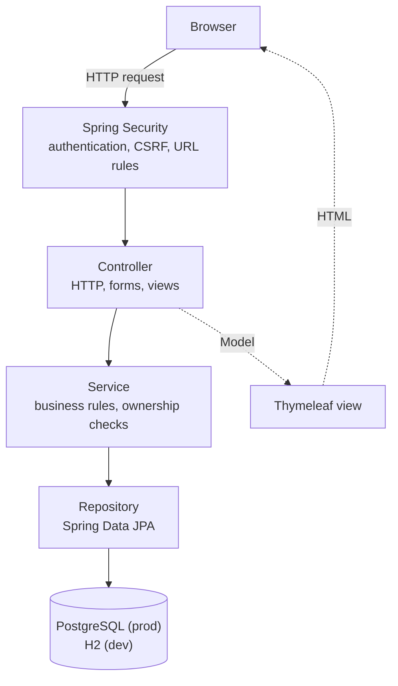
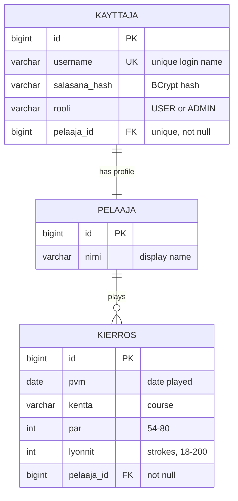

# Golftracker

A full-stack Spring Boot web application for tracking golf rounds. Players sign up, log their rounds and follow their statistics. Regular users can only manage their own rounds, and administrators can manage everyone's.



> **Note:** The user interface is in Finnish, and so are the domain names in the code (see the [glossary](#glossary)).

## Features

- **Accounts and roles:** registration and login, with passwords hashed using BCrypt. There are two roles, `USER` and `ADMIN`.
- **Own rounds only:** users can add, edit and delete only their own rounds. This is checked on the server, so a manually typed URL returns **403 Forbidden**.
- **Player statistics:** number of rounds, best score relative to par, and average score relative to par (e.g. `+9,7`).
- **Validation:** strokes 18–200, par 54–80, course required, no future dates. Errors are shown next to each form field.
- **Responsive UI:** hand-written CSS with no frameworks. On phones, the round tables become stacked cards.
- **Two environments:** H2 in-memory database for development, and PostgreSQL ([Supabase](https://supabase.com)) for production. Credentials come only from environment variables.

## Screenshots

| Login | Round form with validation errors |
|---|---|
|  |  |

| Admin editing another player's round | 403 when editing someone else's round |
|---|---|
|  |  |

<p align="center">
  
  <br><em>Mobile view: tables become stacked cards</em>
</p>

## Tech stack

| Area | Technology |
|---|---|
| Language | Java 21 |
| Framework | Spring Boot 4 (Spring MVC, Spring Data JPA, Spring Security, Bean Validation) |
| Views | Thymeleaf templates and fragments, plain CSS |
| Database | PostgreSQL on Supabase (production), H2 in-memory (development) |
| ORM | Hibernate (JPA) |
| Testing | JUnit 5, MockMvc, Spring Security Test, AssertJ |
| Build | Maven (wrapper included) |

## Architecture

The application has a layered structure, and each layer has one responsibility:



| Layer | Package | Responsibility |
|---|---|---|
| **Spring Security** | `config` | Logs users in through a database-backed `UserDetailsService`, checks CSRF tokens and requires login for every page except login, registration and static files. |
| **Controller** | `controller` | Maps URLs to methods, binds and validates forms (`@Valid`) and chooses which view to render. Contains no business rules. |
| **Service** | `service` | Business logic: registration, statistics and the *"may this user touch this round?"* check. Throws `AccessDeniedException`, which Spring Security turns into **403**. |
| **Repository** | `repository` | Interfaces that extend `JpaRepository`. Spring Data generates the SQL, for example `findByUsername`. |
| **Model / DTO** | `model`, `dto` | JPA entities, plus form and statistics objects that are never saved to the database. |

<details>
<summary>Project structure</summary>

```
src/main/java/com/example/golftracker
├── GolftrackerApplication.java   # entry point + demo data
├── config/                       # SecurityConfig
├── controller/                   # Kierros-, Pelaaja-, Rekisterointi-, KirjautumisController, NavigaatioAdvice
├── service/                      # KierrosService, KayttajaService, PelaajaService, KayttajaUserDetailsService
├── repository/                   # Spring Data JPA repositories
├── model/                        # Kayttaja, Pelaaja, Kierros, Rooli
└── dto/                          # RekisterointiLomake, PelaajaYhteenveto
src/main/resources
├── templates/                    # Thymeleaf views + fragments.html (head, navbar)
├── static/css/style.css          # all styling in one file
├── application.properties        # shared settings
├── application-dev.properties    # H2
└── application-prod.properties   # PostgreSQL via environment variables
```

</details>

## Database



- **`kayttaja` – `pelaaja` (`@OneToOne`):** every login account owns exactly one player profile. The foreign key is in `kayttaja` and has a unique constraint. Login data and golf data are stored separately.
- **`pelaaja` – `kierros` (`@OneToMany` / `@ManyToOne`):** a player has many rounds, and the foreign key `pelaaja_id` is in `kierros`.
- Statistics such as best score and average are calculated from the rounds every time and never stored, so they cannot get out of sync with the rounds.

## Security

| Action | Anonymous | `USER` | `ADMIN` |
|---|:-:|:-:|:-:|
| Register / log in | ✅ | – | – |
| View players, rounds and statistics | – | ✅ | ✅ |
| Add a round | – | ✅ own profile only | ✅ any player |
| Edit / delete a round | – | ✅ own rounds only | ✅ any round |

How permissions are enforced:

- **Server-side ownership check:** `KierrosService.haeMuokattavaksi()` loads the round and compares its owner with the logged-in user before any edit or delete. If they don't match, it throws `AccessDeniedException` and the server responds with **403**. Hiding buttons in the UI is only a convenience.
- **The owner is set on the server:** for regular users, the player is taken from the session, not from the form. `@InitBinder` also stops the `pelaaja` field from being bound from the request (mass-assignment protection), so a modified `pelaajaId` or hidden `id` field has no effect.
- **No state changes with GET:** delete and logout are POST forms with a CSRF token.
- **Passwords:** stored as BCrypt hashes. Registration always gives the `USER` role and uses a separate DTO, so a request cannot set `rooli=ADMIN`.
- **No secrets in the repository:** database credentials come from environment variables. `.env` is git-ignored, and demo accounts are disabled in production by default.

## Getting started

**Requirements:** Java 21. Maven is included through `./mvnw`.

### Development: H2, no configuration needed

```bash
./mvnw spring-boot:run
```

Open <http://localhost:8080>. The `dev` profile is active by default. It uses an in-memory H2 database and creates demo data on every start. The H2 console is at `/h2-console` (JDBC URL `jdbc:h2:mem:golftracker`).

### Production: PostgreSQL / Supabase

1. Create your local `.env` file from the template. It is git-ignored.
   ```bash
   cp .env.example .env
   ```
2. Fill in the values. In Supabase, open **Connect → Session pooler**. The JDBC driver needs the URL in `jdbc:` form, without credentials inside it:
   ```properties
   SPRING_PROFILES_ACTIVE=prod
   DB_URL=jdbc:postgresql://aws-0-<region>.pooler.supabase.com:5432/postgres?sslmode=require
   DB_USERNAME=postgres.<project-ref>
   DB_PASSWORD=<database password>
   DEMO_DATA=false   # true = create demo accounts if the database is empty
   ```
3. Load the variables and run:
   ```bash
   set -a; source .env; set +a
   ./mvnw spring-boot:run
   ```
   In VS Code, you can instead use a Java launch configuration with `"envFile": "${workspaceFolder}/.env"`.

Hibernate creates the tables on first start (`ddl-auto=update`). On Supabase, enable Row Level Security on the tables. The app connects as the `postgres` role, which bypasses RLS, so this only stops access through Supabase's public REST API:

```sql
alter table public.kayttaja enable row level security;
alter table public.pelaaja  enable row level security;
alter table public.kierros  enable row level security;
```

### Demo accounts (dev profile)

| Username | Password | Role | Player |
|---|---|---|---|
| `admin` | `admin` | ADMIN | Palin |
| `user` | `user` | USER | Valtteri |
| `mikko` | `mikko` | USER | Mikko |
| `aino` | `aino` | USER | Aino |

You can also register a new account at `/rekisteroidy`.

## Tests

```bash
./mvnw test
```

25 tests, run against H2. No database setup is needed.

| Test class | What it covers |
|---|---|
| `KierrosOikeudetTest` | A user **cannot** open, save or delete another user's round (403), even with hand-crafted POST requests. A forged `pelaajaId` is ignored. An admin can delete any round. Delete with GET returns 405, and delete without a CSRF token is rejected. Validation errors re-render the form. Registration creates a user and a player with a hashed password, and duplicate usernames are rejected. |
| `SivutTest` | The custom login page and the registration page link to each other. CSS is available without login. Anonymous users are redirected to login. The player list renders the navbar and statistics, and the user's own card is shown first. |
| `PelaajaYhteenvetoTest` | Plain unit tests for the statistics: count, best score relative to par, average, and formatting such as `+11,7`, `E` and `-2`. |
| `ProdProfiiliTest` | The `prod` profile reads the database URL from environment variables, uses a small connection pool and does not create demo accounts. |
| `GolftrackerApplicationTests` | The application context starts. |

## Future improvements

- **REST API:** JSON endpoints (`/api/rounds`) next to the Thymeleaf UI, documented with OpenAPI/Swagger, for example for a mobile client.
- **Flyway migrations:** versioned SQL migrations instead of `ddl-auto=update`, to get reproducible schema changes and history.
- **Cloud deployment:** containerise with Docker and deploy to a platform such as Render or Fly.io. `server.port` already reads `PORT`.
- **CI:** a GitHub Actions workflow that runs `./mvnw test` on every push and pull request.
- **More statistics:** handicap calculation, trends over time and per-course records.
- **Account features:** password change and admin user management.
- **Testcontainers:** run integration tests against a real PostgreSQL instead of H2.

## Glossary

| Finnish | English |
|---|---|
| kayttaja | user (login account) |
| pelaaja | player |
| kierros | round |
| kentta | golf course |
| lyonnit | strokes |
| pvm (päivämäärä) | date |
| rooli | role |
| salasana | password |

## Background

This project began as a coursework assignment for the **Back End Development** course (*Back end -ohjelmointi*) at **Haaga-Helia University of Applied Sciences**. I later extended it into a portfolio project with user accounts, server-side authorisation, validation, a custom UI, PostgreSQL support and tests.

AI (Anthropic's **Claude**) was used as a learning aid and to help write code during development. Every change was reviewed and tested before being merged, and the code comments (in Finnish) explain each part of the code.
